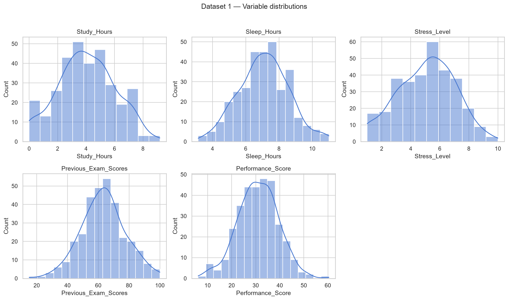
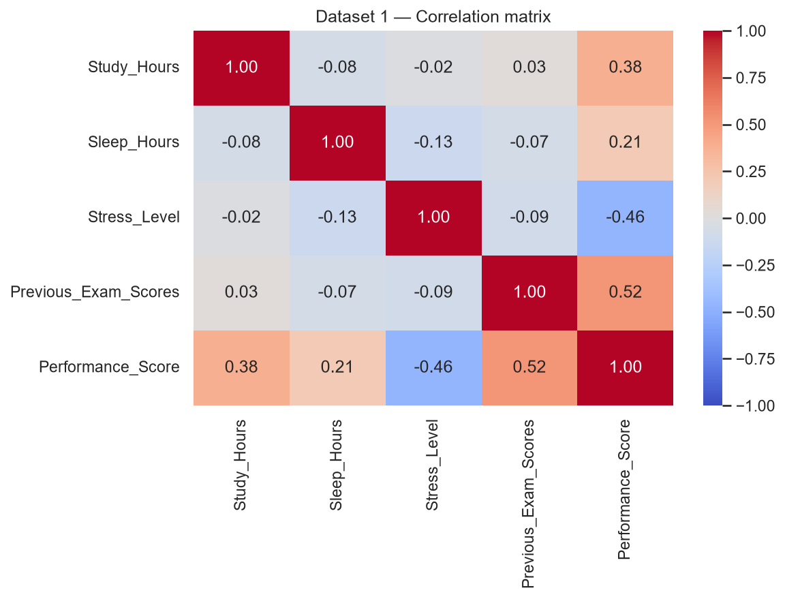
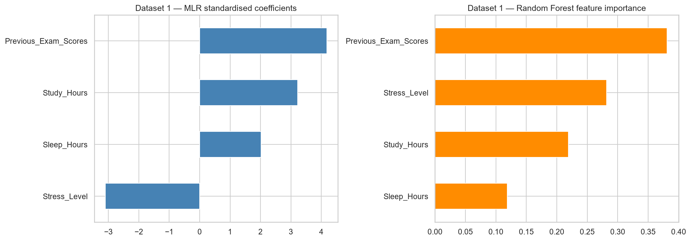
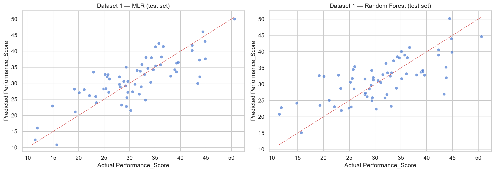
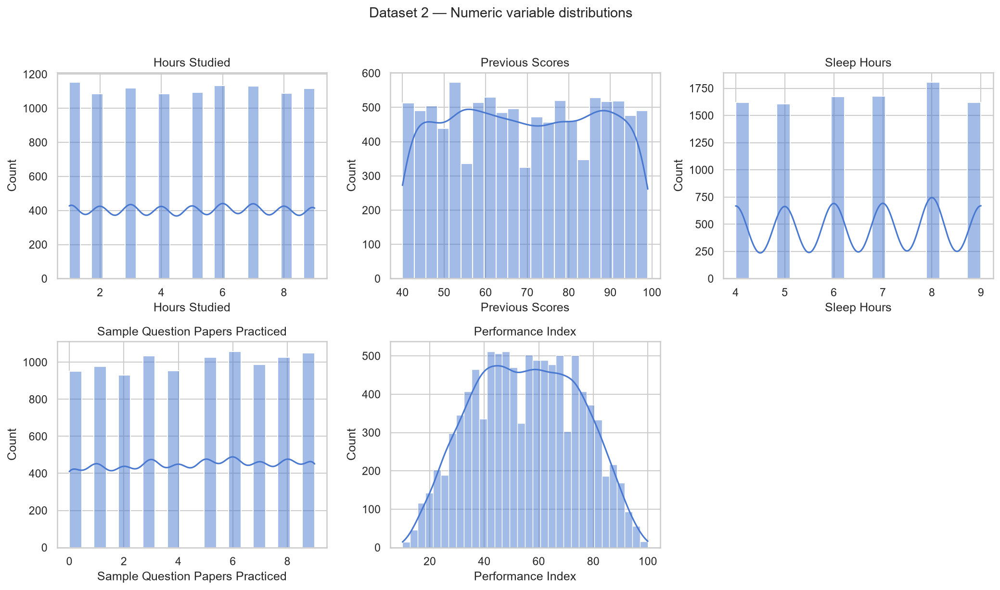
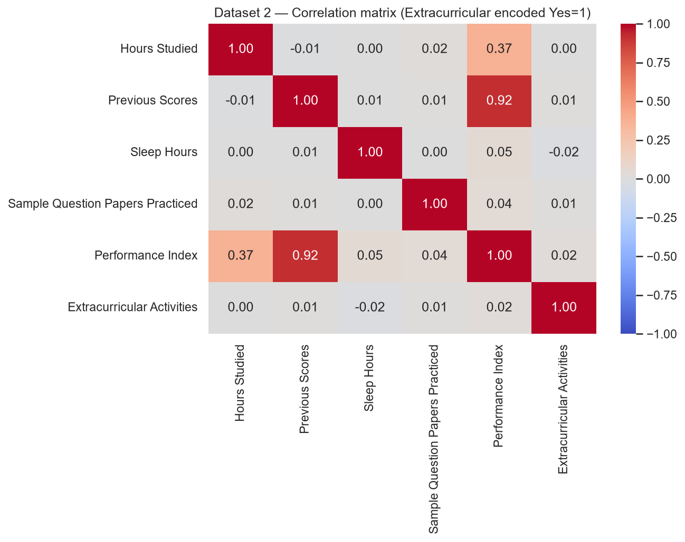
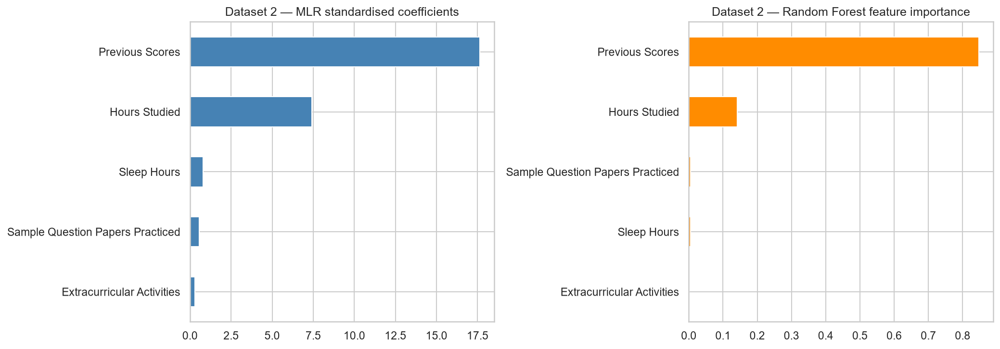
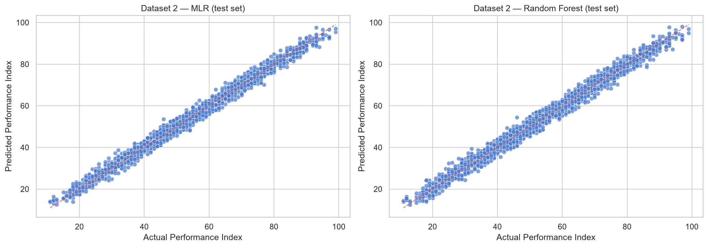
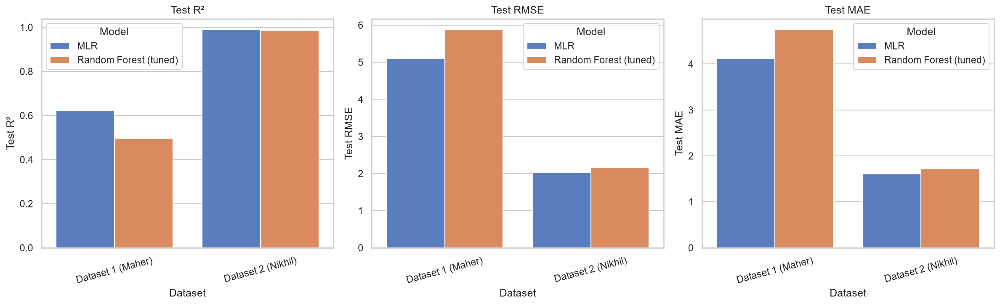
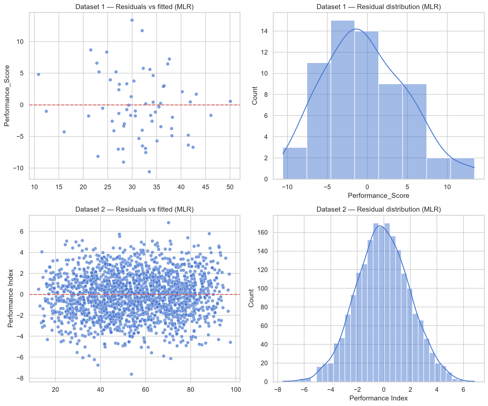

# RPDA8412 Research Project — Cognitive Load and Student Academic Performance

**Student:** Ziyaad Mahomed (ST10228343)  
**Supervisor:** Ebrahim Adam  
**Module:** RPDA8412 — Research Project  
**Institution:** The Independent Institute of Education  

---

## Overview

This repository contains the completed data analysis for a postgraduate research study on **cognitive load factors and student academic performance at tertiary level**. The work applies machine learning to two publicly available synthetic student-performance datasets and interprets the results through cognitive load theory (Sweller, 1988).

The analysis examines whether study behaviour, sleep, stress, prior academic performance, and related proxies show **predictive associations** with academic outcomes. Findings are presented as associations rather than causal claims, consistent with the cross-sectional and synthetic nature of the data.

---

## Research focus

The study responds to three research objectives:

| Objective | Focus |
|---|---|
| **RQ1** | Identify cognitive-load-related factors associated with academic performance |
| **RQ2** | Apply machine learning to predict performance from those factors |
| **RQ3** | Compare Multiple Linear Regression (MLR) and Random Forest Regression |

Variables are mapped onto cognitive load constructs as follows:

| Construct | Meaning | Dataset 1 (Maher, 2024) | Dataset 2 (Nikhil, 2023) |
|---|---|---|---|
| **Intrinsic load** | Prior academic readiness / task difficulty | `Previous_Exam_Scores` | `Previous Scores`, `Sample Question Papers Practiced` |
| **Extraneous load** | External demands on cognitive capacity | `Sleep_Hours`, `Stress_Level` | `Sleep Hours`, `Extracurricular Activities` |
| **Germane load** | Productive academic engagement | `Study_Hours` | `Hours Studied` |
| **Outcome** | Academic performance | `Performance_Score` | `Performance Index` |

---

## Datasets

| Dataset | Source | Records | Outcome variable |
|---|---|---:|---|
| Dataset 1 | [Maher (2024)](https://www.kaggle.com/datasets/mustafamaher2520/student-performance-data) | 321 | `Performance_Score` (approx. 6.07–60.43) |
| Dataset 2 | [Nikhil (2023)](https://www.kaggle.com/datasets/nikhil7280/student-performance-multiple-linear-regression) | 10 000 | `Performance Index` (10–100) |

Both files are stored in `data/` under normalised filenames for reproducibility.

---

## Methodology summary

The workflow implemented in `notebooks/cognitive_load_analysis.ipynb` follows the approved research proposal:

1. Exploratory data analysis on each dataset separately  
2. Preprocessing: identifier removal, categorical encoding, train-test split (80/20)  
3. MLR with standardised predictors as the interpretable baseline  
4. Random Forest Regression as the non-linear comparison model  
5. Random Forest hyperparameter tuning via GridSearchCV with 5-fold cross-validation  
6. Evaluation using **R²**, **RMSE**, and **MAE**  
7. Comparative analysis across datasets, models, and predictor importance  

---

## Key findings

### Dataset 1 — Maher (2024)

Exploratory analysis showed complete records with no missing values in core fields. Correlations indicated that prior exam scores and study hours had the strongest linear relationships with performance.





**Model performance (test set)**

| Model | Test R² | Test RMSE | Test MAE |
|---|---:|---:|---:|
| Multiple Linear Regression | **0.623** | 5.09 | 4.11 |
| Random Forest (baseline) | 0.491 | 5.91 | 4.73 |
| Random Forest (tuned) | 0.497 | 5.88 | 4.75 |

MLR explained **62.3%** of variance in `Performance_Score`, outperforming Random Forest on this dataset. Prior exam scores carried the greatest weight in both models, followed by study hours and stress level. Sleep hours contributed to a lesser extent.





---

### Dataset 2 — Nikhil (2023)

The larger dataset showed very strong linear structure. Previous scores dominated associations with the performance index; hours studied provided additional explanatory value.





**Model performance (test set)**

| Model | Test R² | Test RMSE | Test MAE |
|---|---:|---:|---:|
| Multiple Linear Regression | **0.989** | 2.02 | 1.61 |
| Random Forest (baseline) | 0.986 | 2.27 | 1.81 |
| Random Forest (tuned) | 0.987 | 2.16 | 1.72 |

Both models achieved excellent fit. MLR marginally outperformed Random Forest. `Previous Scores` dominated predictor importance; sleep hours, practice papers, and extracurricular activity played comparatively minor roles.





---

### Cross-dataset model comparison

The comparative view highlights how model choice and dataset structure interact. MLR was the stronger model on Dataset 1, while both approaches converged on Dataset 2.



Full numeric results are exported to:

- `outputs/model_comparison_summary.csv`
- `outputs/feature_rankings.csv`

---

## What the analysis demonstrates

The results support several consistent patterns across both datasets and modelling approaches:

**Prior academic performance as the primary predictor.**  
Previous exam scores and previous scores ranked first in both datasets. This aligns with the intrinsic-load interpretation that academic readiness and accumulated task difficulty are strongly associated with current performance.

**Study engagement as a meaningful secondary factor.**  
Study hours and hours studied appeared among the more influential predictors, particularly in Dataset 1. This supports the germane-load reading that deliberate academic engagement is associated with stronger outcomes.

**Stress as a dataset-specific extraneous-load indicator.**  
Dataset 1 includes a direct stress measure, which ranked alongside study hours in importance. This suggests that cognitive and emotional pressure may be associated with performance variation when such a variable is available.

**Model choice depends on dataset complexity.**  
MLR delivered clearer superiority on the smaller, noisier Dataset 1 and remained competitive on Dataset 2. Random Forest tuning improved performance modestly but did not overturn the overall pattern.

**Residual behaviour for MLR.**  
Residual diagnostics indicated reasonably centred errors for both datasets, supporting transparent reporting of the linear baseline models.



---

## Research question outcomes

| Question | Outcome |
|---|---|
| **RQ1** | Prior performance, study time, and stress (where measured) emerged as the most influential cognitive-load-related proxies |
| **RQ2** | MLR and Random Forest both predicted academic performance with quantifiable R², RMSE, and MAE values |
| **RQ3** | MLR outperformed Random Forest on Dataset 1; both models performed at a similarly high level on Dataset 2 |

---

## Limitations

The analysis rests on **synthetic Kaggle datasets**, so generalisation to real tertiary student populations requires caution. Cognitive load is measured through **behavioural proxies** rather than validated psychometric instruments. The **cross-sectional design** supports association and prediction, not causal inference. Dataset 2’s unusually strong linear fit likely reflects its synthetic construction rather than typical institutional data.

These boundaries are acknowledged throughout the Research Report and do not diminish the value of the analysis as a structured, theory-informed modelling demonstration.

---

## Project structure

```
RPDA8411_Cognitive_Load_Study/
├── data/
│   ├── dataset1_maher_student_performance.csv
│   └── dataset2_nikhil_student_performance.csv
├── notebooks/
│   └── cognitive_load_analysis.ipynb      # Main documented analysis
├── outputs/
│   ├── figures/                           # Report-ready visualisations
│   ├── model_comparison_summary.csv
│   └── feature_rankings.csv
├── docs/
│   ├── Research_Report_Draft.docx              # Summative report (RPDA8412 structure)
│   ├── RPDA8412w_Research_Project_Assessment.pdf  # Official brief + rubric
│   ├── Data_Analysis_Progress_Report.docx
│   └── Discussion_Draft.docx
├── scripts/
│   ├── generate_research_report_draft.py    # Build report (Arial 12, 1.5, annexures)
│   ├── check_assessment_compliance.py       # Word-count & section checklist
│   ├── report_narrative.py / report_narrative_supplement.py
│   ├── proposal_expansion.py                # Proposal text → report (past tense)
│   └── report_tables.py
├── .gitignore
├── requirements.txt
└── README.md
```

---

## Setup and execution

```powershell
cd C:\Users\ziyaa\Documents\RPDA8411_Cognitive_Load_Study
python -m venv .venv
.\.venv\Scripts\Activate.ps1
pip install -r requirements.txt
python -m ipykernel install --user --name rpda8411 --display-name "Python (RPDA8411)"
jupyter notebook notebooks/cognitive_load_analysis.ipynb
```

Running the notebook regenerates all figures in `outputs/figures/` and refreshes the CSV summary files.

To regenerate the summative report and run the compliance check:

```powershell
.\.venv\Scripts\python.exe scripts\generate_research_report_draft.py
.\.venv\Scripts\python.exe scripts\check_assessment_compliance.py
```

The report follows **RPDA8412/w** (see `docs/RPDA8412w_Research_Project_Assessment.pdf`): abstract 250–500 words, body 12 000–17 000 words (excl. references and annexures), Harvard referencing, annexures for ethics and AI disclosure, Turnitin submission. Update the TOC in Word; insert ethics letter and AI chat log in annexures before submission.

---

## Dependencies

| Package | Purpose |
|---|---|
| pandas, numpy | Data handling |
| matplotlib, seaborn | Visualisation |
| scipy | Statistical support |
| scikit-learn | Modelling, preprocessing, evaluation |
| imbalanced-learn | Included per project requirements |
| ipykernel, notebook | Jupyter execution |

See `requirements.txt` for version constraints.

---

## References

Ahmed, W., Wani, M.A. and Plawiak, P., 2025. Machine learning-based academic performance prediction with explainability for enhanced decision-making in educational institutions. *Scientific Reports*, 15(1), pp.1-20.

Badal, Y.T. and Sungkur, R.K., 2022. Predictive modelling and analytics of students' grades using machine learning algorithms. *Education and Information Technologies*, 28(3), pp.3027-3057.

Holicza, B. and Kiss, A., 2023. Predicting and comparing students' online and offline academic performance using machine learning algorithms. *Behavioral Sciences*, 13(4), p.289.

Maher, M., 2024. Student performance data [Dataset]. Kaggle.

Nikhil, 2023. Student performance - multiple linear regression [Dataset]. Kaggle.

Pedregosa, F. et al., 2011. Scikit-learn: machine learning in Python. *Journal of Machine Learning Research*, 12, pp.2825-2830.

Sweller, J., 1988. Cognitive load during problem solving: effects on learning. *Cognitive Science*, 12(2), pp.257-285.

Tripathy, J.P., 2013. Secondary data analysis: ethical issues and challenges. *Iranian Journal of Public Health*, 42(12), pp.1478-1479.

---

*This README summarises the analysis outputs produced for the RPDA8412 Research Report. The notebook contains the full step-by-step discussion, code, and reproducible workflow.*
